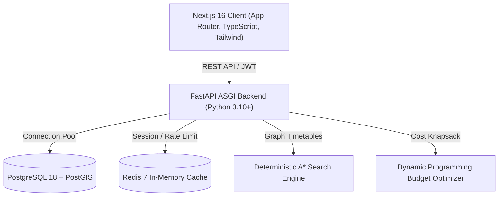

# NAVIX — Algorithmic Budget-First Multi-Modal Travel Planner

> **"Your budget. One complete journey."**

NAVIX is an algorithmic, budget-first multi-modal travel planning platform engineered for travellers exploring India, with specialized routing algorithms for journeys originating from Tier-2 and Tier-3 Indian cities (e.g., **Sangli → Old Manali**, **Pune → Goa**, **Miraj → Jaipur**). 

The platform guarantees that a generated itinerary strictly satisfies a **hard total trip budget constraint**:

$$\text{Total Trip Cost} \le \text{User Maximum Budget}$$

$$\text{Total Cost} = \sum C_{\text{transport}} + \sum C_{\text{stay}} + \sum C_{\text{food}} + \sum C_{\text{activities}} + \sum C_{\text{transfers}} + C_{\text{buffer}}$$

---

## 🌟 Key Highlights & Capabilities

- **Deterministic Routing & Budget Optimization**: No probabilistic hallucination. Core routing uses deterministic time-dependent **A\* Graph Search** with connection safety validation, paired with a **Constrained Dynamic Programming** budget allocation engine.
- **Pan-India Coverage (113 Destinations)**: Explore destinations across 28 states and union territories, categorized into Mountain Trails, Coastal Escapes, Heritage Sanctuaries, Spiritual Corridors, and Adventure circuits.
- **Authentic Photographic System**: Integrated catalog of vetted local photographs for destinations, stays, regional culinary trails, and travel dispatches—strictly zero generic placeholders.
- **Seamless Guest-to-Traveler User Journey**: Unauthenticated travelers can explore India, browse 113 destinations, inspect travel dispatches, and draft itineraries. Intent and composer parameters are preserved during authentication and restored directly to the planner.
- **Travel Command Center**: Modern, editorial traveler dashboard featuring active journey spotlights, frosted-glass budget telemetry, saved journey archives, and duplicate/PDF export actions.
- **Authoritative Multi-Provider Transport Discovery (`/transport`)**: Search timetables across rail, bus, and flights with transparent data provenance and explicit missing-fare disclosures.
- **Travel-Editorial Micro-Accents**: Vintage passport stamps, flight/train trajectory curves, geographic coordinate tags, and cartographic watermarks for a handcrafted field-journal aesthetic.
- **One-Click Offline PDF Itinerary**: Export complete multi-modal schedules, daily stays, activities, and budget ledgers via jsPDF.

---

## 🏗️ Architecture & Technology Stack



| Layer | Technologies & Libraries |
| :--- | :--- |
| **Frontend** | Next.js 16 (Turbopack, App Router), React 19, TypeScript, Tailwind CSS, Lucide Icons, React Leaflet, OpenStreetMap, jsPDF |
| **Backend** | Python 3.10+, FastAPI, SQLAlchemy, Pydantic v2, PyJWT, Passlib (bcrypt), Uvicorn |
| **Database** | PostgreSQL 18 with **PostGIS** spatial extension (Port 5433) |
| **Cache & Queue** | Redis 7 Alpine (Port 6379) |
| **Testing & QA** | Pytest, Playwright E2E Suite, TypeScript type checking, Turbopack production builds |
| **Deployment** | Docker & Docker Compose container orchestration |

---

## 📁 Repository Directory Structure

```text
Navix/
├── docker-compose.yml              # Multi-container orchestration (Frontend, Backend, Redis)
├── AGENTS.md                       # Architectural guidelines & non-destructive DB rules
├── DESIGN.md                       # Editorial travel design system & tokens
├── README.md                       # Main project documentation & run guide
├── docs/                           # Technical engine specifications
│   ├── BUDGET_ENGINE.md            # Constrained knapsack budget mathematical formulation
│   ├── DATABASE_SCHEMA.md          # PostgreSQL + PostGIS schema specification
│   ├── DEMO_DATA.md                # Multi-modal nodes, schedules & corridor mapping
│   ├── IMPLEMENTATION_PLAN.md      # Engineering milestones & release checklist
│   └── ROUTING_ENGINE.md           # A* search & connection layover validation spec
├── backend/                        # FastAPI Python Backend
│   ├── app/
│   │   ├── algorithms/             # Deterministic A* search & DP budget engines
│   │   ├── api/v1/                 # Endpoints (auth, trips, routes, destinations, stories, admin)
│   │   ├── core/                   # Security, settings, and JWT verification
│   │   ├── database/               # SQLAlchemy connection & Base model
│   │   ├── models/                 # ORM tables (users, trips, nodes, schedules, segments)
│   │   ├── schemas/                # Pydantic request/response schemas
│   │   ├── seed/                   # Demo graph & destination seeder scripts
│   │   └── services/               # Orchestration & transport search services
│   ├── tests/                      # Pytest unit & integration test suite
│   ├── Dockerfile                  # Production container definition
│   └── requirements.txt            # Python dependencies
└── frontend/                       # Next.js App Router Frontend
    ├── public/                     # Static media catalog & local photographs
    │   ├── home/                   # 8 local destination hero photographs
    │   └── media/                  # Curated entities, stays, food & stories photography
    ├── src/
    │   ├── app/                    # App Router routes (/, /plan, /dashboard, /explore, /stories, /transport)
    │   ├── components/             # UI component library, Map, TravelAccents
    │   ├── context/                # PlannerContext state provider
    │   ├── lib/                    # Media resolver, draft storage, PDF export
    │   ├── services/               # Typed API client services
    │   └── types/                  # TypeScript interface declarations
    ├── e2e/                        # Playwright automated end-to-end tests
    ├── Dockerfile                  # Next.js production standalone Dockerfile
    └── package.json
```

---

## 🚀 Quickstart & Running the Project

You can run NAVIX either via **Docker Compose** (recommended for production-like evaluation) or **Bare-Metal** for local development.

### Option A: Running with Docker Compose (Recommended)

1. **Verify Prerequisites**: Ensure Docker Desktop is running and PostgreSQL 18 is active on port `5433`.
2. **Start Services**:
   ```bash
   docker compose up -d --build
   ```
3. **Verify Containers**:
   ```bash
   docker ps
   ```
   All 3 services should be up and healthy:
   - `navix-frontend` on `http://localhost:3000`
   - `navix-backend` on `http://localhost:8000`
   - `navix-redis` on `localhost:6379`

---

### Option B: Running Bare-Metal Locally

#### 1. Database Configuration
Ensure PostgreSQL is active on port `5433` with PostGIS enabled:
```sql
CREATE DATABASE "Navix";
\c Navix;
CREATE EXTENSION IF NOT EXISTS postgis;
```

#### 2. Backend Setup
```bash
cd backend

# Create and activate virtual environment
python -m venv .venv
# Windows PowerShell:
.\.venv\Scripts\Activate.ps1
# macOS/Linux:
source .venv/bin/activate

# Install dependencies
pip install -r requirements.txt

# Run idempotent database seed
python -m app.seed.seed_demo_data

# Start FastAPI dev server (Port 8000)
python -m uvicorn app.main:app --host 127.0.0.1 --port 8000 --reload
```
- **Swagger Documentation**: `http://127.0.0.1:8000/docs`
- **Health Check**: `http://127.0.0.1:8000/health`

#### 3. Frontend Setup
```bash
cd frontend

# Install dependencies
npm install

# Start development server (Port 3000)
npm run dev
```
Open `http://localhost:3000` in your browser.

---

## 🔐 Demo Credentials

| Role | Email | Password | Permissions |
| :--- | :--- | :--- | :--- |
| **Traveler** | `traveler@navix.test` | `password123` | Interactive planner, saved trip management, personal dashboard, PDF export |
| **Administrator** | `admin@navix.com` | Configured via `NAVIX_DEMO_ADMIN_PASSWORD` in `.env` | Full access + `/admin` control panel for transit graph, schedules, and user audits |

*Note: New traveler accounts can also be created instantly via `/register`.*

---

## 🧪 Testing & Verification

### 1. Backend Pytest Suite
```bash
cd backend
python -m pytest -v
```
*Executes unit and integration tests covering A\* search, layover validation rules, dynamic programming budget caps, and JWT authentication.*

### 2. Frontend Automated E2E Suite (Playwright)
```bash
cd frontend
npx playwright test e2e/guest-auth-experience.spec.ts
```
*Validates public guest discovery, composer draft retention, login/signup flows, responsive layouts (390px, 768px, 1366px, 1920px), and security guards.*

### 3. Frontend Production Build Check
```bash
cd frontend
npm run build
```
*Runs Turbopack build and TypeScript validation across all static and dynamic routes.*

---

## 🧭 Multi-Modal Routing & Budget Algorithm Details

### 1. Deterministic A\* Search Engine
Unlike naive shortest-path algorithms, NAVIX operates on a **time-dependent transit network graph** containing nodes (stations, bus terminals, airports, interchange hubs) and scheduled segments (trains, intercity buses, regional transport, flights).
- **Layover Safety Evaluation**: Every transfer between segments is classified:
  - `SAFE`: Layover duration $\ge 30\text{ min}$ and within comfortable connection bounds.
  - `TIGHT`: Layover duration between $15\text{ min}$ and $29\text{ min}$ (flagged to traveler).
  - `INVALID`: Transfer duration $< 15\text{ min}$ or negative (pruned from search tree).
- **Hub Transfers**: Accounts for local transfer times when switching modes (e.g., New Delhi Railway Station $\rightarrow$ Kashmiri Gate ISBT).

### 2. Constrained DP Budget Optimizer
Given the computed transport cost $C_{\text{transport}}$, the remaining budget pool is partitioned dynamically:
$$B_{\text{available}} = B_{\text{max}} - C_{\text{transport}} - C_{\text{buffer}}$$

A constrained dynamic programming solver allocates optimal combinations of:
1. **Accommodation**: Vetted homestays, boutique hostels, or mid-tier hotels meeting safety criteria.
2. **Food**: Regional thalis, street food circuits, and verified dining.
3. **Activities**: Destination experiences and local entry passes.
4. **Local Transfers & Reserve**: Last-mile auto/taxi fares and a 5–10% contingency safety margin.

If $C_{\text{transport}} > B_{\text{max}}$, the engine returns an explicit `BUDGET_TOO_LOW` notification with deterministic cost breakdown rather than fabricating unachievable options.

---

## 🎨 UI & Design Principles

NAVIX adheres to a tailored **"Travel Command Center"** design system:
- **Palette**: Deep Navy (`#0C1820`, `#142A38`), Travel Teal (`#1F6E78`), Warm Off-White / Sand (`#FBF7F1`, `#F5EBE1`), and Terracotta Accents (`#E96E55`).
- **Typography**: Editorial serif headings paired with clean, readable sans-serif body type and monospace figures for budget ledgers.
- **Micro-Decorations**: Tactile travel stamps, trajectory curves, and coordinate badges that evoke physical travel journals without UI clutter.
- **Layout Balance**: 55% interactive itinerary timeline / 45% interactive Leaflet route map on desktop; responsive single-column layout on mobile devices.

---

## 📜 Academic Viva & Defense Notes

- **Deterministic Routing**: Explainable and verifiable for academic review; zero non-deterministic LLM output in route selection or budget calculation.
- **Truth in Transit Data**: Missing fares are surfaced explicitly; connection safety is proven mathematically; no hallucinated train or bus numbers.
- **Data Protection**: Passwords hashed with bcrypt; access secured via standard HS256 JWT tokens with role-based claim authorization; PostgreSQL data integrity strictly preserved.

---

## 📄 License & Attribution

Designed and engineered for Indian multi-modal travel research and academic demonstration. All photographic media used under verified editorial licenses and local asset packages.
